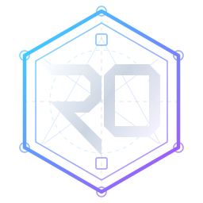

[Português (Brasil)](README.md) | **English** | [Español (América Latina)](README.es.md)

  

# Rodrigo de Oliveira

**Software Architect**

I've spent much of my career trying to understand problems and make systems work. Over time, I've grown just as interested in what happens after delivery as in the code itself: how decisions age, what changes around them, and who has to live with their consequences.

I work in software architecture now, but I still enjoy writing code. Building tools and small projects gives me room to experiment without having to turn every idea into a product. Sometimes the useful lesson is finding out that the simpler solution was enough.

I don't think of architecture as a collection of ready-made answers. I'd rather ask questions, record why a choice was made, and revisit it when the context changes. I've changed my mind about technologies and approaches before, and I see that as part of the job.

That curiosity is one reason I still enjoy working in software engineering.

## More about my work

My background, projects, and writing are on my [portfolio website](https://rodri-oliveira-dev.github.io/en/). You can also read my [resume](https://rodri-oliveira-dev.github.io/en/resume/) or explore my [open-source libraries and tools](https://github.com/rodri-oliveira-dev).

The site is available in [Portuguese](https://rodri-oliveira-dev.github.io/), [English](https://rodri-oliveira-dev.github.io/en/), and [Spanish](https://rodri-oliveira-dev.github.io/es/).

About this repository

This repository hosts my personal website and does not accept external contributions. The source code, written content, and visual assets are proprietary. See the [license](LICENSE) for terms of use. Technical maintenance and publishing details are available in the [repository documentation](.github/AUTOMATION.md) (in Portuguese). The experimental WebMCP integration is documented in [English](docs/webmcp.en.md), [Brazilian Portuguese](docs/webmcp.pt-BR.md), and [Spanish](docs/webmcp.es-419.md).

