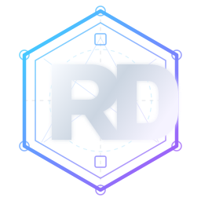

[Português (Brasil)](README.md) | **English** | [Español (América Latina)](README.es.md)

  

# Rodrigo de Oliveira

**Software Architect | Professional Portfolio**

I started my career as a software developer. Over more than 20 years, my work has taken me through integration projects, system modernization, and a wide range of challenges before moving into software architecture.

Along the way, I've learned that good solutions are about more than technology. They need to reflect business priorities, the people involved, and what it takes to keep systems useful and maintainable as things change.

I created this portfolio to share the experiences and lessons that have shaped my career, and to give visitors a sense of how I approach my work.

## What you'll find

- **My career journey:** the experiences, responsibilities, and turning points that shaped my path.
- **Projects and case studies:** real challenges, decisions, and lessons learned.
- **Articles and writing:** perspectives on software architecture and engineering.
- **Beyond the code:** some of the interests and experiences that make up who I am.

## Explore my portfolio

**[Visit my professional website](https://rodri-oliveira-dev.github.io/en/)** to learn more about my background, work, and writing.

Available in [Portuguese](https://rodri-oliveira-dev.github.io/), [English](https://rodri-oliveira-dev.github.io/en/), and [Spanish](https://rodri-oliveira-dev.github.io/es/).

---

If you're looking for my open-source libraries, tools, and contributions, you can also visit my [GitHub profile](https://github.com/rodri-oliveira-dev).

About this repository

This repository hosts my personal website and does not accept external contributions. The source code, written content, and visual assets are proprietary. See the [license](LICENSE) for terms of use. Technical maintenance and publishing details are available in the [repository documentation](.github/AUTOMATION.md) (in Portuguese).

