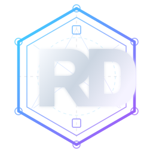

[Português (Brasil)](README.md) | [English](README.en.md) | **Español (América Latina)**

  

# Rodrigo de Oliveira

**Arquitecto de software | Portafolio profesional**

Comencé mi carrera en el desarrollo de software. A lo largo de más de 20 años, he participado en proyectos de integración, modernización de sistemas y distintos desafíos que me llevaron a dedicarme a la arquitectura de software.

En ese recorrido aprendí que una buena solución va más allá de la tecnología. También debe tener en cuenta las necesidades del negocio, a las personas involucradas y las condiciones reales para que los sistemas puedan evolucionar.

Creé este portafolio para compartir las experiencias y los aprendizajes que han marcado mi trayectoria, y para mostrar mi manera de entender el trabajo que hago.

## Qué encontrarás

- **Mi trayectoria:** experiencias, responsabilidades y momentos importantes de mi carrera.
- **Proyectos y casos de estudio:** desafíos reales, decisiones y lecciones aprendidas.
- **Artículos y publicaciones:** reflexiones sobre arquitectura e ingeniería de software.
- **Más allá del código:** algunos intereses y experiencias que también forman parte de quien soy.

## Conoce mi portafolio

**[Visita mi sitio profesional](https://rodri-oliveira-dev.github.io/es/)** para conocer mi trayectoria, mis trabajos y mis publicaciones.

Disponible en [portugués](https://rodri-oliveira-dev.github.io/), [inglés](https://rodri-oliveira-dev.github.io/en/) y [español](https://rodri-oliveira-dev.github.io/es/).

---

Si quieres explorar mis bibliotecas, herramientas y contribuciones de código abierto, también puedes visitar mi [perfil de GitHub](https://github.com/rodri-oliveira-dev).

Sobre este repositorio

Este repositorio aloja mi sitio web personal y no acepta contribuciones externas. El código, los textos y los materiales visuales son propietarios. Consulta la [licencia](LICENSE) para conocer los términos de uso. Los detalles técnicos de mantenimiento y publicación están en la [documentación del repositorio](.github/AUTOMATION.md) (en portugués). La integración experimental WebMCP está documentada en [español](docs/webmcp.es-419.md), [portugués](docs/webmcp.pt-BR.md) e [inglés](docs/webmcp.en.md).

