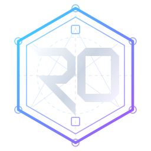

[Português (Brasil)](README.md) | [English](README.en.md) | **Español (América Latina)**

  

# Rodrigo de Oliveira

**Arquitecto de software**

Pasé buena parte de mi carrera tratando de entender problemas y hacer que los sistemas funcionen. Con el tiempo, empecé a interesarme tanto por lo que pasa después de una entrega como por el código: cómo envejecen las decisiones, qué cambia a su alrededor y quién convive con sus consecuencias.

Hoy trabajo en arquitectura de software, pero sigo disfrutando de programar. Crear herramientas y proyectos pequeños me da espacio para experimentar sin convertir cada idea en un producto. A veces, lo más útil es descubrir que la solución más sencilla era suficiente.

No veo la arquitectura como una colección de respuestas prefabricadas. Prefiero hacer preguntas, registrar por qué elegí un camino y volver a evaluarlo cuando cambia el contexto. He cambiado de opinión sobre tecnologías y enfoques, y creo que eso también forma parte del trabajo.

Esa curiosidad es una de las razones por las que todavía disfruto la ingeniería de software.

## Más sobre mi trabajo

Mi trayectoria, mis proyectos y publicaciones están en mi [portafolio](https://rodri-oliveira-dev.github.io/es/). También puedes consultar mi [currículum](https://rodri-oliveira-dev.github.io/es/curriculo/) o explorar mis [bibliotecas y herramientas de código abierto](https://github.com/rodri-oliveira-dev).

El sitio está disponible en [portugués](https://rodri-oliveira-dev.github.io/), [inglés](https://rodri-oliveira-dev.github.io/en/) y [español](https://rodri-oliveira-dev.github.io/es/).

Sobre este repositorio

Este repositorio aloja mi sitio web personal y no acepta contribuciones externas. El código, los textos y los materiales visuales son propietarios. Consulta la [licencia](LICENSE) para conocer los términos de uso. Los detalles técnicos de mantenimiento y publicación están en la [documentación del repositorio](.github/AUTOMATION.md) (en portugués). La integración experimental WebMCP está documentada en [español](docs/webmcp.es-419.md), [portugués](docs/webmcp.pt-BR.md) e [inglés](docs/webmcp.en.md).

