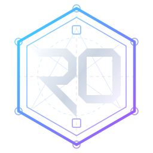

**Português (Brasil)** | [English](README.en.md) | [Español (América Latina)](README.es.md)

  

# Rodrigo de Oliveira

**Arquiteto de Software**

Passei boa parte da carreira tentando entender problemas e fazer sistemas funcionarem. Com o tempo, comecei a me interessar tanto pelo que acontece depois da entrega quanto pelo código em si: como uma decisão envelhece, o que muda ao redor dela e quem precisa conviver com suas consequências.

Hoje trabalho com arquitetura, mas continuo gostando de programar. Criar ferramentas e pequenos projetos me dá espaço para experimentar sem a obrigação de transformar cada ideia em produto. Às vezes, o aprendizado está justamente em descobrir que a solução mais simples era suficiente.

Não vejo arquitetura como uma coleção de respostas prontas. Prefiro fazer perguntas, registrar o motivo das escolhas e voltar a elas quando o contexto muda. Já mudei de opinião sobre tecnologias e abordagens, e considero isso parte do trabalho.

É essa curiosidade que continua me aproximando da engenharia de software.

## Mais sobre meu trabalho

Minha trajetória, meus projetos e publicações estão no [portfólio](https://rodri-oliveira-dev.github.io/). Também é possível consultar meu [currículo](https://rodri-oliveira-dev.github.io/curriculo/) e explorar minhas [bibliotecas e ferramentas públicas](https://github.com/rodri-oliveira-dev).

O site está disponível em [português](https://rodri-oliveira-dev.github.io/), [inglês](https://rodri-oliveira-dev.github.io/en/) e [espanhol](https://rodri-oliveira-dev.github.io/es/).

Sobre este repositório

Este repositório mantém meu site pessoal e não recebe contribuições externas. O código, os textos e os materiais visuais são proprietários. Consulte a [licença](LICENSE) para os termos de uso. Os detalhes técnicos de manutenção e publicação estão na [documentação do repositório](.github/AUTOMATION.md). A integração experimental WebMCP está documentada em [português](docs/webmcp.pt-BR.md), [inglês](docs/webmcp.en.md) e [espanhol](docs/webmcp.es-419.md).

