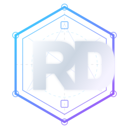

**Português (Brasil)** | [English](README.en.md) | [Español (América Latina)](README.es.md)

  

# Rodrigo de Oliveira

**Arquiteto de Software | Portfólio profissional**

Minha trajetória começou no desenvolvimento de software. Ao longo de mais de 20 anos, passei por projetos de integração, modernização de sistemas e diferentes desafios até chegar à arquitetura de software.

Nesse caminho, aprendi que uma boa solução não depende apenas de tecnologia. Ela precisa considerar o contexto do negócio, as pessoas envolvidas e as condições reais para evoluir e continuar fazendo sentido com o tempo.

Criei este portfólio para reunir experiências e aprendizados que ajudam a contar essa história, além de mostrar como penso e atuo profissionalmente.

## O que você vai encontrar

- **Minha trajetória:** experiências, responsabilidades e momentos que marcaram minha carreira.
- **Projetos e estudos de caso:** trabalhos que mostram desafios, escolhas e aprendizados na prática.
- **Artigos e publicações:** reflexões sobre arquitetura e engenharia de software.
- **Além do código:** um pouco dos interesses e experiências que também fazem parte de quem sou.

## Conheça meu portfólio

**[Visite meu site profissional](https://rodri-oliveira-dev.github.io/)** para explorar minha trajetória, meus trabalhos e minhas publicações.

Disponível em [português](https://rodri-oliveira-dev.github.io/), [inglês](https://rodri-oliveira-dev.github.io/en/) e [espanhol](https://rodri-oliveira-dev.github.io/es/).

---

Para conhecer minhas bibliotecas, ferramentas e contribuições open source, visite também meu [perfil no GitHub](https://github.com/rodri-oliveira-dev).

Sobre este repositório

Este repositório mantém meu site pessoal e não recebe contribuições externas. O código, os textos e os materiais visuais são proprietários. Consulte a [licença](LICENSE) para os termos de uso. Os detalhes técnicos de manutenção e publicação estão na [documentação do repositório](.github/AUTOMATION.md). A integração experimental WebMCP está documentada em [português](docs/webmcp.pt-BR.md), [inglês](docs/webmcp.en.md) e [espanhol](docs/webmcp.es-419.md).

